# ☢️ Nusantara Wars

Game strategi real-time ala *Age of Empires* yang berjalan di browser (three.js + TypeScript). Pilih suku **Jawa** atau **Sunda**, bangun ekonomi, lewati empat zaman dengan teknologi berlandaskan **kearifan lokal**, hadapi AI, dan luncurkan **nuklir** dengan efek sinematik, dibumbui sedikit komedi Punakawan.

Semua model 3D dibuat di **Blender**, semua tekstur (termasuk motif batik) dan seluruh suara dibuat secara **prosedural lewat kode**. Tidak ada aset pihak ketiga.

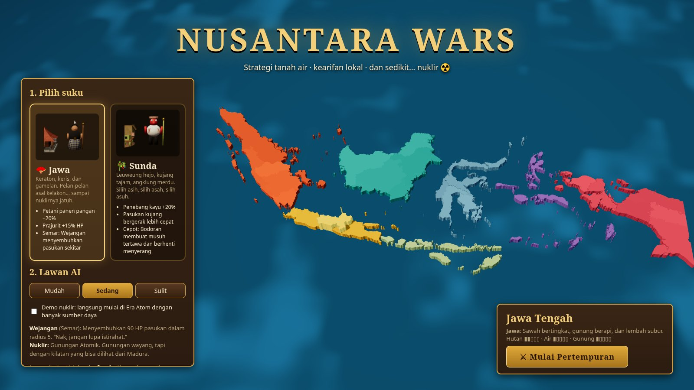

> Menu utama: klik provinsi di peta Indonesia 3D (38 provinsi, beranimasi) untuk memilih medan tempur. Bioma peta mengikuti wilayah provinsi.

## Daftar isi
- [Menjalankan](#menjalankan)
- [Zaman per suku](#zaman-per-suku-epoch-14)
- [Mekanik game](#mekanik-game)
- [Nuklir: Jawa jadi sasaran](#nuklir-jawa-jadi-sasaran)
- [Kontrol](#kontrol)
- [Model Blender dan file `.blend`](#model-blender-dan-file-blend)
- [Arsitektur](#arsitektur)
- [Keterbatasan dan rencana](#keterbatasan-dan-rencana)

## Menjalankan

```bash
npm install
npm run dev          # http://localhost:5173
npm test             # 14 tes simulasi (peta, ekonomi, pertempuran, AI, nuklir, kemampuan hero)
npm run build        # build produksi ke dist/
```

Di menu, centang **Demo nuklir** untuk langsung mulai di Era Atom dengan reaktor siap pakai dan sumber daya melimpah. Galeri model tersedia di `/gallery.html?set=units|buildings|nature`.

## Zaman per suku (epoch 1–4)

Setiap suku punya empat zaman sendiri. Naik zaman dilakukan di markas dan membuka unit, bangunan, serta teknologi baru (+10% HP dan serangan pasukan per zaman). Zaman terakhir membuka **reaktor nuklir**.

### Jawa 🪭

| | |
|---|---|
| 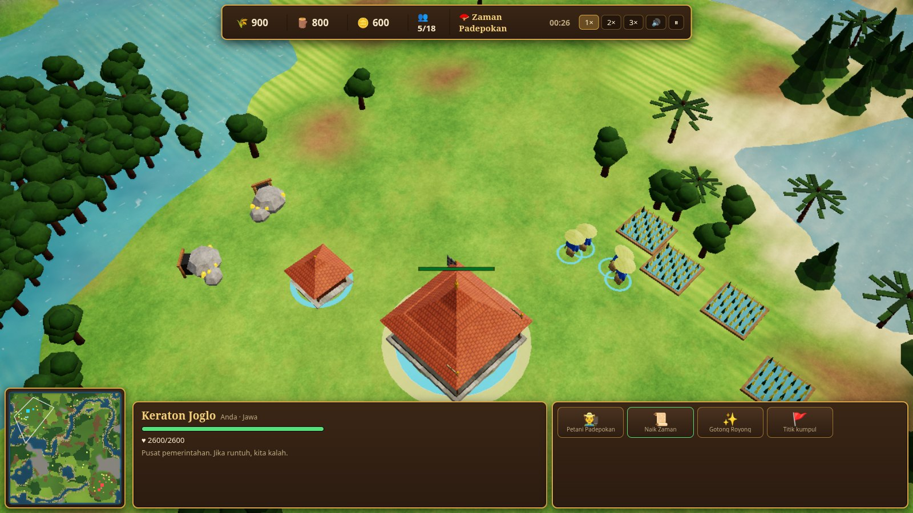 | 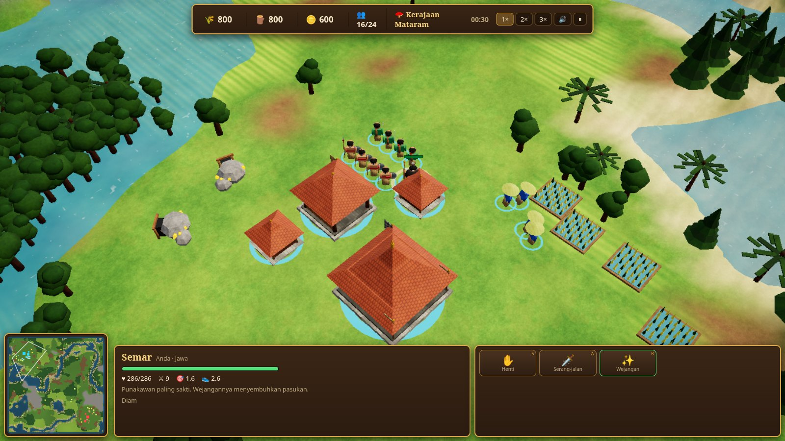 |
| **1. Zaman Padepokan**: sawah, gotong royong, Keraton Joglo dan omah joglo | **2. Kerajaan Mataram**: pendopo prajurit, pemanah, dan hero **Semar** |
| 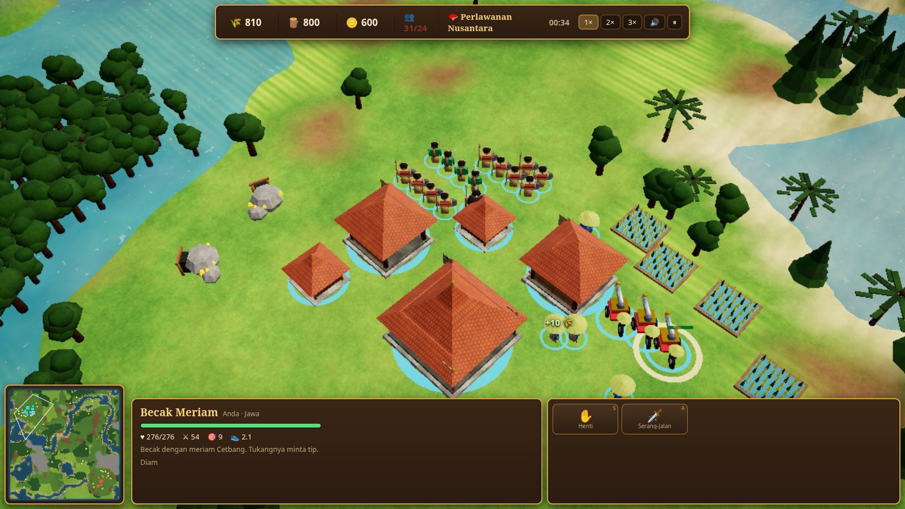 | 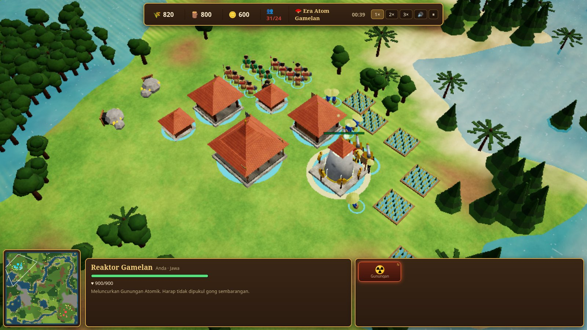 |
| **3. Perlawanan Nusantara**: **Becak Meriam** masuk medan perang | **4. Era Atom Gamelan**: **Reaktor Gamelan** (gong emas + inti hijau) |

### Sunda 🎋

| | |
|---|---|
| 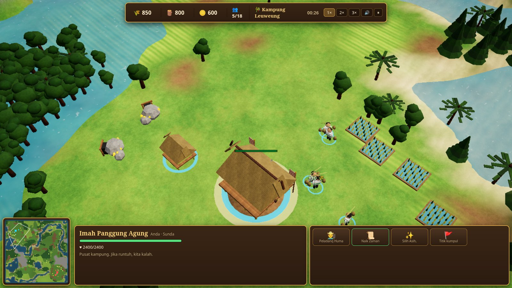 | 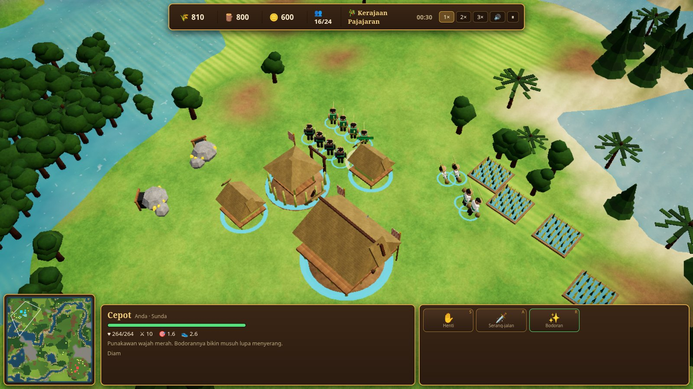 |
| **1. Kampung Leuweung**: Imah Panggung Agung beratap ijuk *julang ngapak* | **2. Kerajaan Pajajaran**: Bale Pasukan, Pasukan Kujang, penyumpit, hero **Cepot** |
| 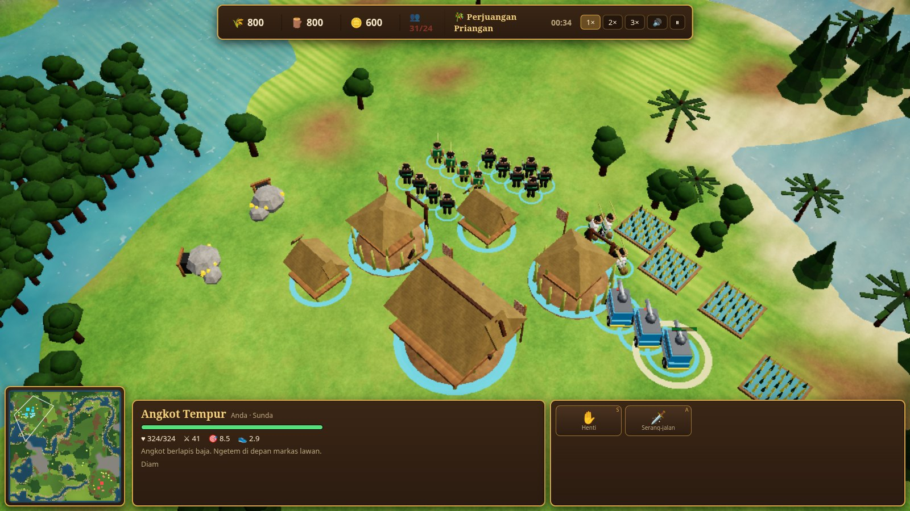 | 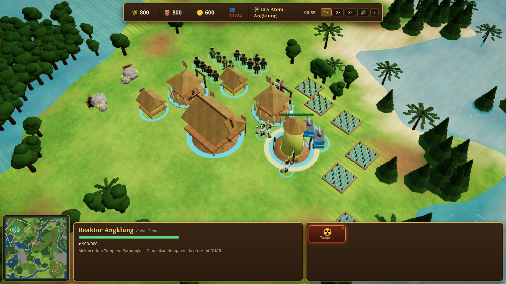 |
| **3. Perjuangan Priangan**: **Angkot Tempur** berlapis baja | **4. Era Atom Angklung**: **Reaktor Angklung** (bambu + inti sian) |

| | Jawa | Sunda |
|---|---|---|
| Epoch 1 / 2 / 3 / 4 | Zaman Padepokan → Kerajaan Mataram → Perlawanan Nusantara → Era Atom Gamelan | Kampung Leuweung → Kerajaan Pajajaran → Perjuangan Priangan → Era Atom Angklung |
| Markas | Keraton Joglo (atap tumpang sari) | Imah Panggung Agung (atap ijuk) |
| Nuklir | **Gunungan Atomik** (awan jamur ala gunungan wayang) | **Tumpeng Pamungkas** |

## Mekanik game

### Tujuan dan alur
Mode **skirmish PvE** melawan satu AI di peta prosedural 128×128. **Menang** dengan meruntuhkan markas lawan (Keraton Joglo / Imah Panggung Agung); **kalah** jika markas Anda runtuh. Mulai dengan 1 markas, 5 petani, dan 260 🌾 / 220 🪵 / 120 🪙, lalu: panen → bangun rumah dan barak → latih pasukan → naik zaman → (Era Atom) reaktor → nuklir.

### Ekonomi
| Sumber daya | Asal | Catatan |
|---|---|---|
| 🌾 Pangan | **Sawah** (600, **tumbuh kembali** 0,9/detik) | Dasar semua unit. Jawa memanen +20% |
| 🪵 Kayu | **Pohon** (100 per pohon) | Bangunan dan pasukan. Sunda memanen +20% |
| 🪙 Emas | **Tambang** (1300) | Teknologi, kendaraan, hero, nuklir |

Petani memanen sekitar 1 unit/detik, membawa 10, lalu otomatis mengantar ke markas dan kembali ke sumber yang sama (atau mencari yang terdekat bila habis). Unit baru dengan titik kumpul di sawah/pohon langsung memanen. **Populasi**: markas +12, tiap rumah +6; hero dan kendaraan tempur memakan 3 populasi.

### Unit

| Peran | Jawa | Sunda | Biaya | Zaman |
|---|---|---|---|---|
| Petani | Petani Padepokan (40 HP) | Peladang Huma (40 HP) | 50 🌾 | 1 |
| Prajurit | **Prajurit Keris** 100 HP, 11 dmg | **Pasukan Kujang** 88 HP, 11 dmg, **lebih cepat** | 45 🌾 35 🪵 | 1 |
| Pemanah | **Pemanah Mataram** 55 HP, 9 dmg, jarak 7 | **Penyumpit Leuweung** 52 HP, 7 dmg, jarak 6,5, **racun** 4 detik | 30 🌾 50 🪵 | 2 |
| Kendaraan | **Becak Meriam** 230 HP, 45 dmg, jarak 9 | **Angkot Tempur** 270 HP, 34 dmg, jarak 8,5, lebih cepat | 150 🪵 120 🪙 | 3 |
| Hero | **Semar** 260 HP | **Cepot** 240 HP | 150 🌾 100 🪙 | 2 |

Kendaraan tempur menghasilkan 2,5× kerusakan ke bangunan dan memercikkan 50% kerusakan ke unit di sekitar sasaran. Hero hanya boleh satu pada satu waktu.

**Kemampuan hero** (`R`):
- **Wejangan (Semar)**: menyembuhkan 90 HP semua pasukan dalam radius ±5,5 petak. Jeda 18 detik.
- **Bodoran (Cepot)**: semua musuh dalam radius ±5,5 petak tertawa dan terhenti 4 detik. Jeda 20 detik.

### Bangunan

| Bangunan | HP | Biaya / waktu | Fungsi |
|---|---|---|---|
| Keraton Joglo / Imah Panggung Agung | 2600 / 2400 | awal | Latih petani dan hero, naik zaman, teknologi |
| Omah Joglo / Imah Panggung Leutik | 360 / 320 | 60 🪵, 14 d | +6 populasi |
| Pendopo Prajurit / Bale Pasukan | 1200 / 1100 | 150 🪵, 30 d | Latih prajurit, pemanah, kendaraan |
| Reaktor Gamelan / Reaktor Angklung | 900 | 300 🪵 300 🪙 200 🌾, 45 d (zaman 4, maks. 2) | Meluncurkan nuklir |

Petani membangun bersama: pilih beberapa petani lalu klik kanan bangunan yang belum selesai untuk membantu. Bangunan yang rusak parah terbakar.

### Naik zaman dan teknologi
| Naik ke | Biaya | Waktu |
|---|---|---|
| Zaman 2 | 200 🌾 150 🪵 | 25 d |
| Zaman 3 | 400 🌾 300 🪵 200 🪙 | 35 d |
| Zaman 4 | 700 🌾 600 🪵 500 🪙 | 45 d |

Setiap suku punya **tiga teknologi kearifan lokal** (dibuka berurutan per zaman, diteliti di markas):

| Zaman | Jawa | Sunda |
|---|---|---|
| 1 | **Gotong Royong**: bangunan selesai 50% lebih cepat. *"Berat sama dipikul, ringan sama dijinjing."* | **Silih Asih, Silih Asah, Silih Asuh**: panen +15%. *"Saling mengasihi, mengasah, mengasuh."* |
| 2 | **Gamelan Perang**: serangan pasukan +12%. *"Harmoni mengalahkan kebisingan."* | **Leuweung Larangan**: pasukan +15% kecepatan, pemanah +15% serangan. *"Leuweung ruksak, cai beak."* |
| 3 | **Memayu Hayuning Bawana**: HP +15%, kebal 50% radiasi | **Hirup Sauyunan**: HP +10%, kebal 50% radiasi |

### Pertempuran
- Pasukan yang diam **otomatis menyerang** musuh dalam jarak pandang (9 petak) dan membalas bila diserang. Perintah **serang-sambil-jalan** (`A`) membuat pasukan menghajar apa pun di jalan.
- Kerusakan = serangan × bonus zaman/teknologi. Infanteri hanya memberi **45%** kerusakan ke bangunan; kendaraan tempur 250%.
- Unit saling mendorong (tabrakan lunak), pasukan membentuk formasi di titik tujuan, dan jalur dihitung dengan **A\*** (jalur dibagi untuk pasukan satu perintah).
- Tim dibedakan cincin warna di kaki unit: **cyan = Anda**, **merah = musuh**.

### Lawan AI
AI memakai perintah yang sama dengan pemain: mengatur panen berdasarkan stok, membangun rumah/barak/reaktor, menabung untuk naik zaman, melatih campuran pasukan, bertahan jika markas diserang, mengirim **gelombang serangan** yang membesar, dan **meluncurkan nuklir** begitu tersedia. Tiga tingkat kesulitan (Mudah/Sedang/Sulit) menggeser jadwal naik zaman, jumlah petani, dan ukuran gelombang.

### Kemampuan nuklir ☢️

| Parameter | Nilai |
|---|---|
| Biaya | 400 🪙 + 200 🌾 |
| Hitung mundur | **20 detik** (rudal terbang 4,5 detik terakhir dan tak bisa dicegat) |
| Pembatalan | Hancurkan **silo penembak** sebelum rudal diluncurkan |
| Radius ledakan | 9 petak; unit dalam 4,5 petak langsung tewas |
| Gelombang kejut | Melaju 30 petak/detik, kerusakan jatuh tepat saat gelombang tiba |
| Kerusakan | Unit: `HP×1,6×(1−jarak/radius)^0,7`; bangunan: `3200×(1−jarak/radius)^0,7`; pohon dalam 85% radius terbakar |
| Sisa radiasi | Zona radius 7 petak selama **28 detik**, 4 kerusakan/detik pada unit (dikurangi teknologi tahan radiasi) |
| Jeda | 100 detik setelah peluncuran |
| Efek bumi | **Tanah hangus permanen** (terlihat juga di minimap) |

Selama hitung mundur, semua pemain melihat sirene, banner peringatan dengan penghitung, **zona bahaya merah** di tanah, dan lingkaran di minimap.

## Nuklir: Jawa jadi sasaran

Contoh: Sunda (pemain) meluncurkan **Tumpeng Pamungkas** ke **Keraton Joglo** milik Jawa.

| | |
|---|---|
| 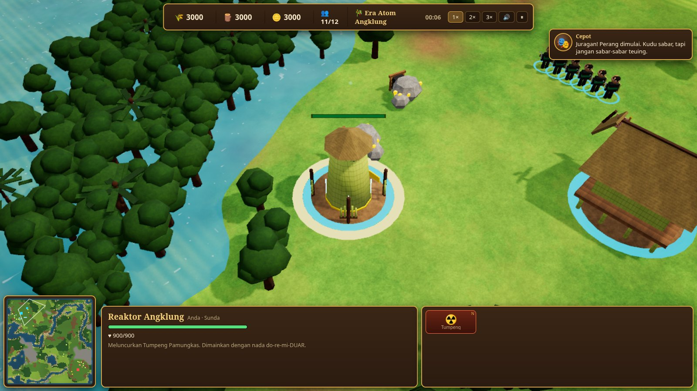 | 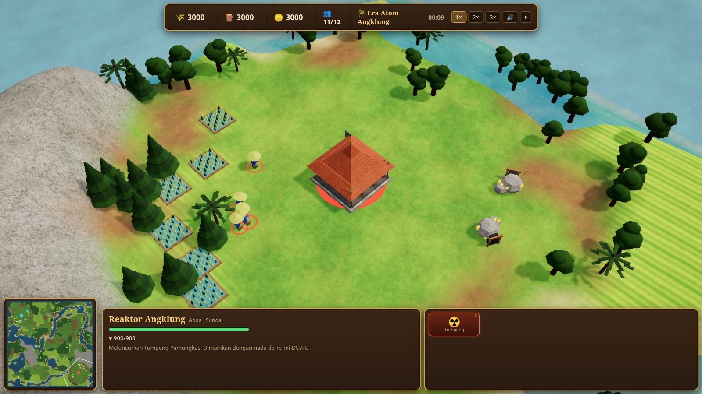 |
| **1.** Reaktor Angklung siap meluncurkan | **2.** Keraton Joglo Jawa sebelum diserang |
| 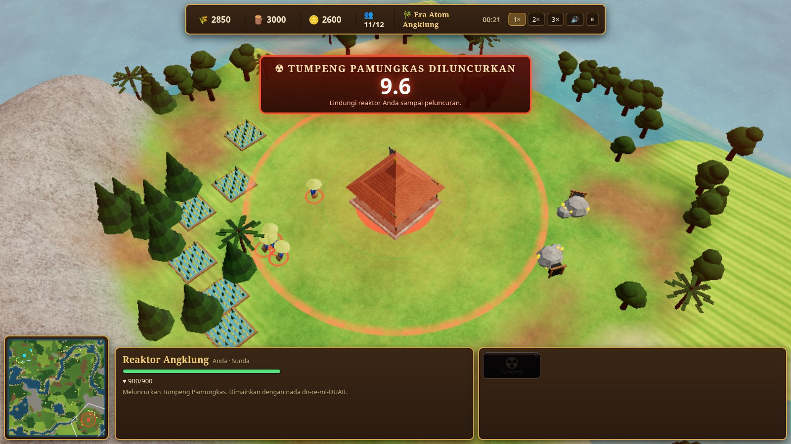 | 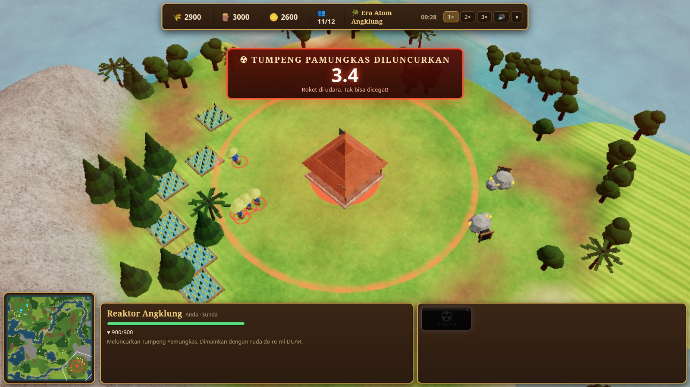 |
| **3.** Hitung mundur, sirene, dan zona bahaya merah mengurung Keraton | **4.** Roket di udara, tak bisa dicegat lagi |
| 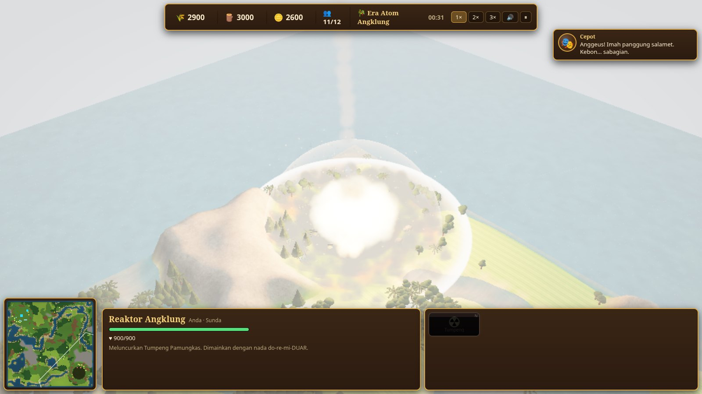 | 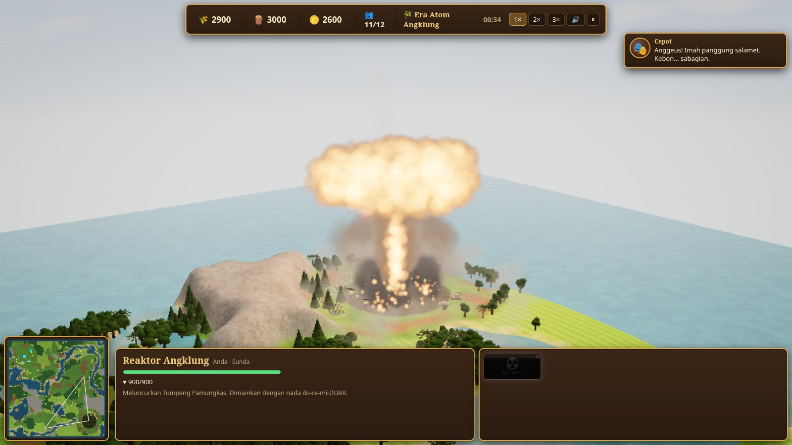 |
| **5.** Kilatan putih dan gelombang kejut | **6.** Bola api membesar, pohon terbakar |
| 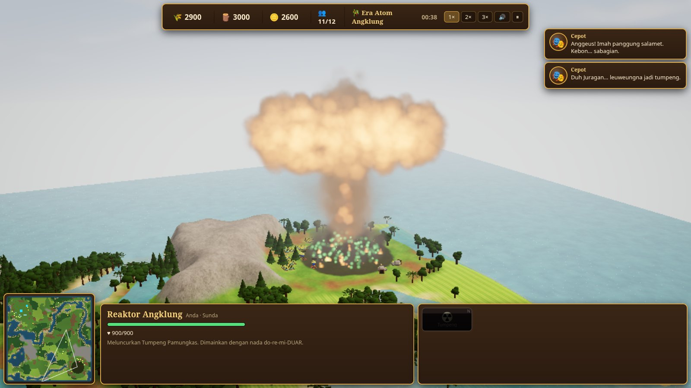 | 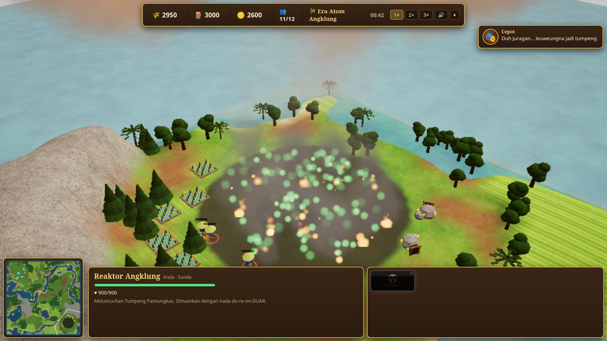 |
| **7.** Kamera sinematik menarik mundur: batang dan tudung awan jamur bergulung | **8.** Awan menjulang dan mendingin |
| 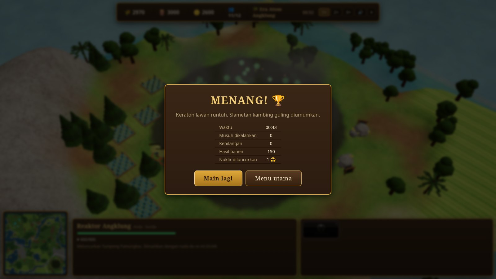 | 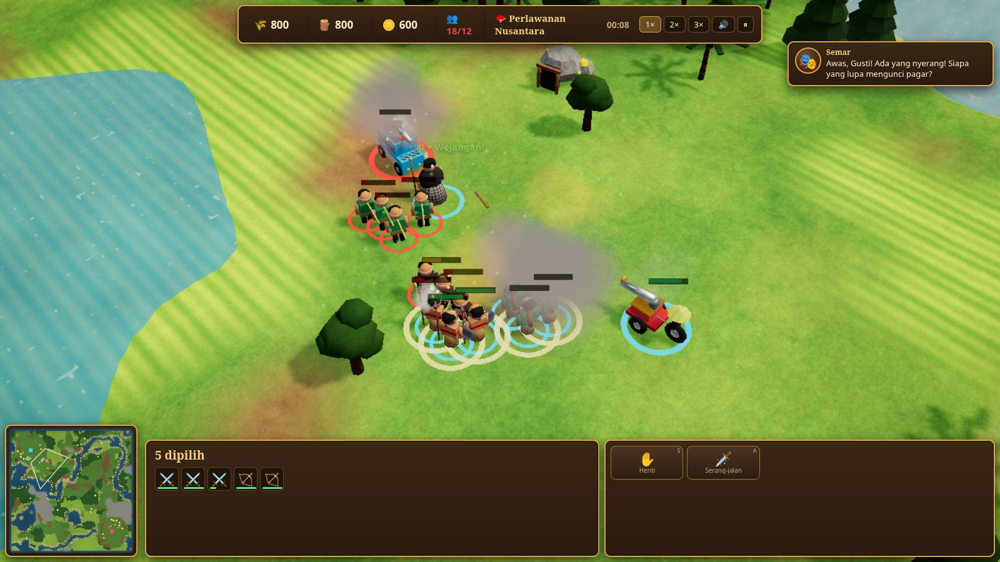 |
| **9.** Tanah hangus, bara, dan hujan radiasi hijau | Pertempuran: becak meriam vs angkot tempur, dengan kemampuan hero Semar |

Efeknya: kilatan, bola api, batang dan tudung awan jamur yang berputar secara analitik (torus), gelombang kejut dan kubah, puing dan percikan, bara, hujan radiasi, getaran kamera, bloom, dan pewarnaan debu. Kamera sinematik bisa dilewati dengan menekan tombol apa saja.

## Kontrol

| Aksi | Kontrol |
|---|---|
| Pilih / kotak seleksi / klik ganda (semua sejenis di layar) | Klik kiri / drag / klik ganda |
| Perintah: panen, serang, jalan, bantu bangun | Klik kanan |
| Geser kamera | `WASD`, panah, atau dorong mouse ke tepi layar (`Shift` = cepat) |
| Zoom / putar | Scroll / `Q` `E` atau drag tombol tengah |
| Grup pasukan | `Ctrl+1..9` simpan, `1..9` panggil (dua kali = fokus kamera) |
| Serang-sambil-jalan, henti | `A`, `S` |
| Kembali ke markas, petani menganggur | `H`, `.` |
| Kemampuan hero, nuklir, jeda | `R`, `N`, `P` |
| Batalkan mode bangun / target | `Esc` |

Penasihat (**Semar** untuk Jawa, **Cepot** untuk Sunda) melontarkan komentar lucu pada peristiwa penting. Humor lahir dari situasi dan karakter, tidak merendahkan budaya mana pun.

## Model Blender dan file `.blend`

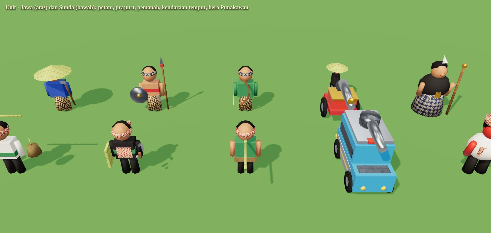
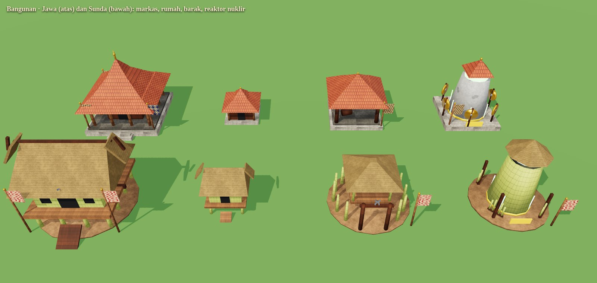
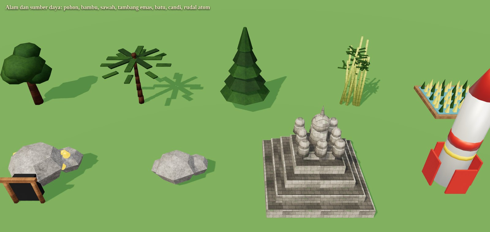

27 model low-poly (unit, bangunan, pohon, sawah, tambang emas, candi, rudal atom) dibangun lewat skrip `bmesh` dengan UV dan material bertekstur, lalu diekspor ke `public/assets/models/*.glb` (tekstur JPEG tertanam, total ±5 MB).

| Berkas | Isi |
|---|---|
| [`tools/blender/nusantara-models.blend`](tools/blender/nusantara-models.blend) | **File Blender**: semua model + peta provinsi. Tekstur dirujuk relatif ke `tools/textures_src/` |
| `tools/blender/lib.py` | Pustaka pembangun (kubus, silinder, atap limas, busur, material bertekstur, ekspor glTF) |
| `tools/blender/units.py`, `buildings.py`, `nature.py` | Definisi tiap model |
| `tools/gen_textures.py` | Generator tekstur tileable 512 px (rumput, tanah, pasir, batu, sawah, kayu, ijuk, genteng, batu candi, bambu, batik parang/kawung/megamendung) |
| `tools/textures_src/` | Hasil tekstur (sumber untuk Blender) |

Membuat ulang model dari terminal Python Blender (Blender 5.x):

```python
import sys; sys.path.insert(0, "tools/blender")
import units, buildings, nature
units.build_all(); buildings.build_all(); nature.build_all()   # mengekspor ke public/assets/models/
```

> Konvensi: 1 satuan = 1 petak peta; model menghadap −Y di Blender (→ +Z di glTF), origin di tengah-bawah. Skrip memakai path absolut `/home/nst/WebstormProjects/wars/...` di `tools/blender/lib.py` (`TEX_DIR`, `OUT_DIR`); sesuaikan jika repo berada di folder lain.

Peta provinsi (`public/assets/models/indonesia-map.glb`, animasi *Intro* dan *Wave*) dibuat dari GeoJSON 38 provinsi.

## Arsitektur

```
src/sim/       simulasi murni (tanpa three.js): peta prosedural, A*, dunia, AI. Tick tetap 20 Hz, deterministik
src/render/    three.js: terrain ter-splat 6 tekstur, air, langit, model ter-instancing, bayangan, post-processing
src/fx/        partikel billboard, efek nuklir (awan torus, gelombang kejut, rudal, zona bahaya)
src/input/     kamera RTS, seleksi, perintah, mode penempatan
src/ui/        HUD DOM, menu + peta Indonesia 3D
src/audio/     musik gamelan prosedural (slendro/pelog) + efek suara (WebAudio)
src/data/      data suku, unit, bangunan, teknologi, dialog
tools/         generator tekstur dan skrip Blender
docs/          ringkasan desain dan screenshot
```

Input hanya menghasilkan objek `Command`; AI memakai perintah yang sama. Render membaca state simulasi dan menginterpolasi antar tick. **Performa**: ≈220 draw call berkat `InstancedMesh`, culling jarak per instance, dan resolusi/kualitas turun otomatis bila FPS rendah (bayangan → MSAA → bloom); bisa diatur manual lewat menu jeda (`P`).

## Keterbatasan dan rencana
- Belum ada fog of war, multiplayer, atau menara pertahanan.
- Pathfinding A* dengan cache jalur bersama (belum flow field); cukup untuk ratusan unit.
- Dua suku. Menambah suku = entri baru di `src/data/game.ts` + model di `tools/blender/`.
- Ide lanjutan: campaign di peta provinsi, suku ketiga (Bugis/Dayak), kota-kota sasaran, dan pertahanan anti-rudal.
